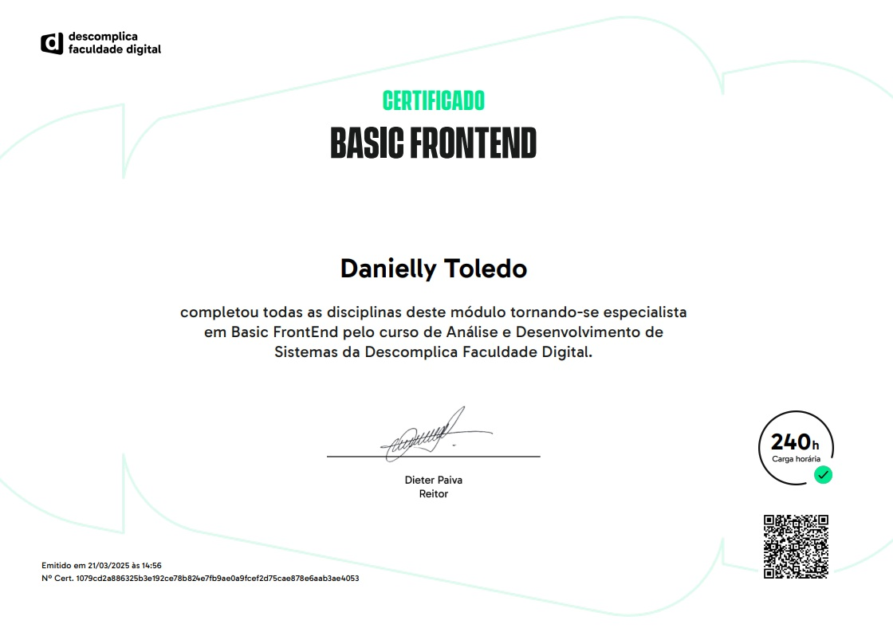

# Módulo 1A — Desenvolvimento Dinâmico, Desenvolvimento Frontend e Experiência do Usuário

Este módulo abrange três grandes áreas complementares do desenvolvimento web: **Desenvolvimento Dinâmico**, com foco em JavaScript, manipulação do DOM e consumo de APIs; **Desenvolvimento Frontend**, envolvendo HTML, CSS, Bootstrap e publicação de websites; e **Experiência do Usuário (UX)**, que aborda os fundamentos do design de interfaces, acessibilidade, pesquisa com utilizadores, prototipagem e avaliação da experiência.

Em conjunto, essas áreas fornecem uma base para desenvolver aplicações web funcionais, responsivas, acessíveis e orientadas às necessidades dos utilizadores, integrando conhecimentos técnicos de programação com princípios de design e usabilidade.

---

## 📁 Desenvolvimento Dinâmico

Introdução aos fundamentos de JavaScript e ao desenvolvimento de páginas web interativas, desde a utilização de funções, operadores e estruturas de repetição até à programação orientada a objetos, manipulação do DOM, tratamento de eventos, programação assíncrona e comunicação com APIs.

### 00 — Introdução ao JavaScript
Fundamentos da linguagem **JavaScript**, a sua importância no desenvolvimento web e a relação com HTML e CSS. Conceitos iniciais de programação, sintaxe, variáveis, tipos de dados e execução de scripts no navegador. Introdução ao papel do JavaScript na criação de páginas dinâmicas e interativas.

### 01 — Funções JavaScript
Definição e utilização de **funções** para organizar e reutilizar blocos de código. Declaração de funções, parâmetros, argumentos, valores de retorno e diferentes formas de escrita, incluindo **Arrow Functions**. Conceitos de escopo e aplicações práticas na organização da lógica de programação.

### 02 — Operadores e Operações
Principais operadores da linguagem JavaScript: **aritméticos, de atribuição, comparação e lógicos**. Utilização de expressões para realizar cálculos, comparar valores e construir condições. Diferenças entre igualdade simples e estrita, precedência de operadores e aplicações nas estruturas de decisão.

### 03 — Instruções de Repetição
Estruturas utilizadas para executar blocos de código repetidamente. Funcionamento de **`for`, `while` e `do...while`**, utilização de condições de paragem e controlo de fluxo com `break` e `continue`. Aplicações na automatização de tarefas e processamento de conjuntos de dados.

### 04 — Trabalhando com Strings
Manipulação de **cadeias de caracteres (strings)** em JavaScript. Propriedades e métodos para consultar, pesquisar, modificar e transformar textos. Concatenação, Template Literals, extração de caracteres e aplicação de operações com strings no desenvolvimento web.

### 05 — JSON
Conceito de **JSON (JavaScript Object Notation)** como formato de representação e intercâmbio de dados. Estrutura de objetos e arrays em JSON, tipos de valores permitidos e diferenças em relação aos objetos JavaScript. Utilização de **`JSON.parse()` e `JSON.stringify()`** na conversão e manipulação de informações, especialmente na comunicação com APIs.

### 06 — Arrays
Conceito e funcionamento dos **arrays** como estruturas para armazenar coleções de valores. Acesso a elementos através de índices, inclusão, alteração e remoção de dados. Métodos de manipulação e iteração, incluindo operações utilizadas para percorrer, filtrar e transformar coleções.

### 07 — Orientação a Objetos
Fundamentos da **Programação Orientada a Objetos (POO)** aplicados ao JavaScript. Conceitos de objetos, propriedades, métodos, classes, construtores e instâncias. Introdução aos princípios de **encapsulamento, herança e polimorfismo**, demonstrando como organizar programas através de estruturas reutilizáveis.

### 08 — Exceções
Tratamento de erros e exceções em JavaScript através das estruturas **`try`, `catch`, `finally` e `throw`**. Identificação de problemas durante a execução, lançamento de erros personalizados e implementação de mecanismos para evitar interrupções inesperadas nas aplicações.

### 09 — Promessas
Introdução à **programação assíncrona** em JavaScript. Conceito de Promises e os seus estados: pendente, cumprida e rejeitada. Utilização de **`.then()`, `.catch()`, `.finally()` e `async/await`** para controlar operações assíncronas, tratar falhas e organizar processos que dependem de respostas externas.

### 10 — HTML Básico
Fundamentos da linguagem de marcação **HTML (HyperText Markup Language)**. Estrutura básica de um documento, organização de conteúdos através de elementos e atributos, utilização de títulos, parágrafos, links e imagens. Relação entre HTML, CSS e JavaScript na construção de páginas web.

### 11 — Elementos DOM
Conceito de **DOM (Document Object Model)** como representação estruturada dos documentos HTML. Seleção e manipulação de elementos através de JavaScript, modificação de conteúdos, atributos e estilos. Criação e remoção dinâmica de elementos para atualizar a interface sem modificar diretamente o ficheiro HTML.

### 12 — Eventos
Funcionamento dos **eventos no navegador** e a sua importância para a interatividade. Utilização de **`addEventListener()`** para responder a cliques, alterações em formulários, movimentos do ponteiro e interações com o teclado. Conceitos de objeto de evento, propagação e controlo de comportamentos através de `preventDefault()`.

### 13 — Consumo de API
Conceito de **API (Application Programming Interface)** e a sua utilização na comunicação entre aplicações. Introdução às requisições HTTP, métodos GET e POST e utilização da **Fetch API**. Tratamento de respostas JSON, operações assíncronas com `async/await`, identificação de erros e apresentação de dados externos numa página web.

### 14 — Desenvolvimento Dinâmico
Integração dos conhecimentos de HTML, CSS e JavaScript para desenvolver páginas que respondem às ações dos utilizadores. Manipulação dinâmica de conteúdos, utilização de eventos, atualização de interfaces e comunicação com fontes externas de dados. Aplicação conjunta dos conceitos estudados para construir funcionalidades web interativas.

### 15 — Boas Práticas de Mercado
Princípios de **qualidade, organização e manutenção de código** utilizados no desenvolvimento de software. Legibilidade, reutilização, padronização e separação de responsabilidades. Importância do versionamento, documentação, tratamento de erros, acessibilidade, segurança e colaboração em projetos de desenvolvimento web.

---

## 📁 Desenvolvimento Frontend

Estudo das tecnologias e ferramentas utilizadas para construir a interface visual de aplicações web, desde os fundamentos da internet e a configuração do ambiente de desenvolvimento até à estilização com CSS, criação de layouts, utilização de componentes Bootstrap e publicação de websites através do GitHub Pages.

### 00 — Internet
História e evolução da **internet**, desde as primeiras redes de computadores até à World Wide Web. Diferenças entre internet e web, importância do **W3C** na padronização das tecnologias, funcionamento dos navegadores (**browsers**) e motores de renderização. Introdução aos motores de pesquisa e aos processos envolvidos na apresentação de páginas web.

### 01 — IDE
Conceito de **IDE (Integrated Development Environment)** e diferenças entre ambientes integrados e editores de código. Exemplos de ferramentas como Visual Studio Code, WebStorm e IntelliJ IDEA. Importância da configuração inicial do ambiente, identificação dos principais elementos da interface e utilização de **extensões** para formatação, depuração, versionamento e produtividade.

### 02 — CSS
Fundamentos do **CSS (Cascading Style Sheets)** e a sua função na apresentação visual das páginas HTML. Estrutura de regras, seletores, propriedades e valores. Introdução aos **modelos de formatação**, incluindo Block, Inline, Flexbox e Grid. Funcionamento do **Box Model**, propriedades de dimensão, espaçamento, cores, tipografia e posicionamento.

### 03 — Recursos Especiais do CSS
Utilização de recursos avançados de estilização, começando pela propriedade **`box-sizing`** e a sua influência no cálculo das dimensões dos elementos. Criação de **gradientes** lineares, radiais e cónicos. Desenvolvimento de **animações com `@keyframes`** e utilização de **transições** para suavizar alterações visuais e melhorar as interações.

### 04 — Layout
Conceito de **layout** e organização visual dos elementos numa página web. Identificação dos diferentes modelos, com destaque para **layout centralizado, fixo e elástico**. Utilização de larguras máximas, margens automáticas, unidades relativas e recursos como Flexbox e Grid. Comparação entre estratégias de dimensionamento e adaptação a diferentes ecrãs.

### 05 — Estilizando
Personalização da aparência dos elementos HTML através de **bordas, sombras, opacidade e gradientes**. Utilização de `border`, `border-radius`, `box-shadow`, `text-shadow` e `opacity`. Aplicação de gradientes para criar fundos e componentes visualmente destacados, considerando consistência visual, contraste e legibilidade.

### 06 — Listas e Fontes
Fundamentos de **tipografia web**, incluindo famílias tipográficas, tamanhos, pesos, estilos e alinhamento de textos. Utilização de propriedades como `font-family`, `font-size`, `font-weight` e `text-align`. Estruturação de informações com listas HTML **ordenadas (`ol`), não ordenadas (`ul`) e descritivas (`dl`)**, incluindo listas aninhadas para representar relações hierárquicas.

### 07 — Tabelas
Criação de **tabelas HTML** para organizar dados em linhas e colunas. Utilização dos elementos **`thead`, `tbody` e `tfoot`** para estruturar cabeçalhos, conteúdos e resumos. Atributos como `colspan`, `rowspan` e `scope`. Estilização com CSS, controlo de bordas, espaçamentos, alinhamentos e responsividade. Aplicações em relatórios, horários, produtos e apresentação de informações provenientes de APIs.

### 08 — Formulários
Construção de **formulários HTML** para recolher dados dos utilizadores. Utilização de diferentes tipos de **`input`**, campos **`textarea`**, listas de seleção com `select` e agrupamentos com **`fieldset` e `legend`**. Associação de labels, campos ocultos, e-mail e data. Funcionamento dos botões de submissão, limpeza e ações personalizadas.

### 09 — Melhorando os Formulários
Aprofundamento dos formulários através dos métodos HTTP **GET e POST** e das diferenças no envio de informações. Configuração da **submissão de formulários**, utilização de eventos JavaScript e `FormData`. Implementação de validações, mensagens de erro claras e feedback visual. Utilização correta do atributo **`placeholder`** para fornecer exemplos de preenchimento, considerando usabilidade, acessibilidade e segurança.

### 10 — Efeitos
Aplicação de **transformações CSS** através da propriedade `transform`. Utilização de **`rotate()`** para girar elementos, **`scale()`** para alterar a escala, **`skew()`** para inclinar e **`translate()`** para deslocar componentes. Combinação de transformações com transições e animações para criar efeitos interativos em botões, imagens e cartões.

### 11 — Bootstrap Básico
Introdução ao **Bootstrap**, desde a sua origem e evolução até à utilização como framework frontend. Configuração através de CDN, npm ou ficheiros locais. Funcionamento do **sistema de Grid de 12 colunas**, containers, rows, columns e breakpoints responsivos. Apresentação dos principais componentes reutilizáveis, como botões, cards, formulários, tabelas e barras de navegação.

### 12 — Bootstrap Intermediário
Desenvolvimento de **menus de navegação responsivos** utilizando Navbar, Collapse e Dropdown. Personalização de textos através das classes utilitárias de **tipografia**, incluindo tamanhos, pesos, cores e alinhamentos. Criação de **botões estilizados**, variantes e grupos de botões. Aplicação de técnicas de **design responsivo** através de Grid, Flexbox, breakpoints e classes utilitárias.

### 13 — Bootstrap Avançado
Utilização de componentes avançados do Bootstrap para melhorar a apresentação e a interação das interfaces. Estilização de **imagens responsivas**, criação de **cards** com imagens, títulos e botões, implementação de **janelas modais** controladas por atributos HTML e JavaScript, e construção de **tabelas responsivas e estilizadas** com diferentes variantes de apresentação.

### 14 — GitHub Pages
Introdução ao **GitHub Pages** como serviço de hospedagem de websites estáticos. Diferenças entre Git, GitHub e GitHub Pages, tipos de websites suportados e limitações de hospedagem. Configuração de repositórios, seleção da origem de publicação e utilização de branches. Publicação de projetos HTML, CSS e JavaScript, atualização através de commits e resolução de problemas comuns relacionados com URLs e caminhos de ficheiros.

---

## 📁 Experiência do Usuário

Introdução aos fundamentos de **UX (User Experience)**, envolvendo a compreensão das necessidades dos utilizadores, a organização de interfaces, o desenvolvimento de soluções acessíveis e a aplicação de metodologias de pesquisa, prototipagem, testes e melhoria contínua.

### 00 — Introdução ao UX e UI
Conceitos fundamentais de **User Experience (UX)** e **User Interface (UI)**. Diferenças entre a experiência proporcionada por um produto e os elementos visuais utilizados na sua interface. Relação entre usabilidade, funcionalidade, acessibilidade e satisfação dos utilizadores no desenvolvimento de produtos digitais.

### 01 — Elementos da Interface do Usuário
Estudo dos elementos que compõem uma **interface de utilizador**, incluindo componentes visuais, mecanismos de navegação, organização de conteúdos e elementos de interação. Importância da consistência e da clareza na apresentação das informações para facilitar a utilização de sistemas e aplicações.

### 02 — Mercado de UX
Visão geral do **mercado de trabalho em UX**, das áreas de atuação e das competências envolvidas no desenvolvimento de experiências digitais. Relação entre design, tecnologia, comportamento dos utilizadores e objetivos de negócio, considerando a importância do UX nos processos de criação e melhoria de produtos.

### 03 — Fundamentos da Identidade Visual
Conceitos de **identidade visual** e a sua importância na comunicação de marcas e produtos digitais. Utilização de cores, tipografia, formas, elementos gráficos e princípios de composição para desenvolver interfaces consistentes, reconhecíveis e alinhadas à proposta de um produto.

### 04 — Design Inclusivo e Acessibilidade
Introdução ao **design inclusivo** e à **acessibilidade digital**, considerando diferentes capacidades, necessidades e contextos de utilização. Princípios para desenvolver interfaces compreensíveis e utilizáveis por públicos diversos, incluindo atenção à legibilidade, contraste, navegação e interação.

### 05 — Design Thinking: Empatia e Definição
Estudo das etapas de **empatia e definição** do Design Thinking. Compreensão das necessidades, dificuldades e expectativas dos utilizadores, identificação de problemas e organização das informações recolhidas para orientar o desenvolvimento de soluções centradas nas pessoas.

### 06 — Pesquisa UX
Fundamentos da **pesquisa com utilizadores (UX Research)** e da recolha de informações para compreender comportamentos, necessidades e experiências. Importância de entrevistas, observações, questionários e análise de dados para apoiar decisões de design e identificar oportunidades de melhoria.

### 07 — Ideação UX
Processo de **ideação** como etapa de geração, exploração e seleção de possíveis soluções. Utilização de pensamento criativo e colaboração para transformar problemas identificados em propostas de funcionalidades, interfaces e experiências que possam ser avaliadas posteriormente.

### 08 — Prototipagem Detalhada
Conceito de **prototipagem** e a sua aplicação na representação de soluções antes do desenvolvimento definitivo. Organização de ecrãs, fluxos de navegação, componentes e interações. Importância dos protótipos para comunicar ideias, avaliar alternativas e identificar problemas antecipadamente.

### 09 — Testando com Usuários
Fundamentos dos **testes de usabilidade** para avaliar a interação de pessoas com interfaces e protótipos. Observação de comportamentos, identificação de dificuldades e recolha de feedback. Utilização dos resultados para compreender problemas de navegação, clareza e eficiência na experiência.

### 10 — Metodologias Ágeis UX
Relação entre **UX e metodologias ágeis**, considerando o desenvolvimento iterativo de produtos digitais. Integração das atividades de pesquisa, design, prototipagem e validação com ciclos de trabalho, colaboração entre equipas e entregas incrementais.

### 11 — Métricas e KPIs UX
Introdução às **métricas e indicadores-chave de desempenho (KPIs)** utilizados na avaliação da experiência do utilizador. Importância de acompanhar resultados relacionados com usabilidade, satisfação, eficiência e comportamento, utilizando informações quantitativas e qualitativas para apoiar decisões.

### 12 — Iteração e Feedback UX
Conceito de **melhoria contínua da experiência do utilizador** através de ciclos de avaliação, feedback e aperfeiçoamento. Análise dos resultados de pesquisas e testes, identificação de oportunidades de melhoria e realização de ajustes progressivos em interfaces e funcionalidades.

### 13 — Como Trabalhar em um Projeto UX
Visão geral da organização e desenvolvimento de um **projeto de UX**, integrando as etapas de compreensão do problema, pesquisa, definição, ideação, prototipagem, testes e iteração. Importância da documentação, comunicação, colaboração e alinhamento entre as necessidades dos utilizadores e os objetivos do projeto.

---

## 🏆 Certificado

